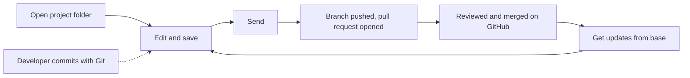

# Hybrid project scenarios

[Back to scenario index](../scenarios.md)

A hybrid project is a project folder inside a code repository, for example `contoso-app/cutready/`.
Business users edit it through a Draftline host. Developers edit the same repository with their own
tools and plain Git. Draftline is a guest in that repository: it works the way the GitHub Copilot app
does and never takes it over.

| Rule | What Draftline does |
|---|---|
| One repository | Opening a folder inside a repository joins it. Draftline never creates a nested `.git`. |
| One workspace per checkout | A checkout has one branch, so it holds one Draftline workspace. A host with many projects keeps them inside that workspace's folder; separate copies use owned worktrees. |
| Stay in the folder | Saves, restores, and shelves read and write only the project folder. Merges bring in the whole branch but keep the developer's index and unrelated local edits. |
| Never rewrite | No squash, cleanup, or force push. Shared history only grows. |
| Share by pull request | Send pushes a branch and opens a pull request. It never pushes to the base branch. |
| Own names only | Draftline creates branches under the host's namespace (for example `cutready/`), refs under `refs/draftline/`, and `draftline-*` worktrees. It never touches other tools' refs or worktrees. The one exception: Send returns the local base branch to its upstream after moving saves off it. |

## Flow 15: open a project inside a code repository

Business goal: "Open our deck that lives in the app's repository."

| Question | Answer |
|---|---|
| Covered today? | Covered. |
| Correct primitive path | `init_with_policy` or `open_with_policy` on the project folder, then `with_variation_namespace("cutready/")`. Tauri hosts set the same namespace once on `DraftlineCommandContext::with_variation_namespace`. `scope()` returns the folder; it is empty for a standalone project. |
| Safety behavior | The enclosing repository (or linked worktree) is discovered, never nested. Changes outside the folder are invisible. A folder that resolves outside the repository is rejected. The namespace hides developers' branches; the base branch and the current branch stay listed. Creating, switching to, renaming, deleting, adopting, restoring onto, or directly publishing a branch outside the namespace fails with `VariationOutsideNamespace` (`variation_outside_namespace`); switching back to the base is allowed, and project changes are shared through Send. Like `git switch`, a switch also updates committed code that differs between branches; files with uncommitted changes in the way block it. |
| Tests | `init_in_project_folder_joins_enclosing_repo_without_nesting`, `changes_outside_project_folder_are_invisible`, `project_folder_in_linked_worktree_scopes_to_worktree`, `variation_namespace_hides_developer_branches`, `namespaced_workspace_leaves_developer_branches_alone`. |

## Flow 15a: save and go back next to a developer

Business goal: "Save my edits without disturbing the developer's code."

| Question | Answer |
|---|---|
| Covered today? | Covered. |
| Correct primitive path | `save_version`, `restore_version_as_new_save`, `shelve_changes` / `apply_shelf` as usual. |
| Safety behavior | A save builds its commit from one reading of HEAD plus the folder's changes, so it never reverts a developer commit that lands mid-save: it saves again on top of that commit. It refuses with `LocalStateChanged` instead if that commit already holds the edits, or if the branch was switched, reset, or rewound. Whatever the developer staged stays staged and uncommitted. Restores and shelves write only the folder and refuse when an untracked or ignored file is in the way. Files that need a Git filter (for example Git LFS) are never saved, overwritten, or discarded: Draftline cannot run the filter, so it refuses with a `GitFilter` hazard before writing anything. Line endings follow `core.autocrlf` and `.gitattributes` the same way Git does. When another Git process holds the index or the branch's ref lock, Draftline waits up to two seconds for it, then refuses with `GitIndexLocked` (`git_index_locked`). A lock found before an operation starts changes nothing. A lock that appears mid-operation leaves a recovery record: rollback undoes a restore only for files still at the restored version, keeps a shelf once any of its edits left the disk, and stops a discard where it is. An interrupted switch or restore onto another branch is rolled back or finished across the whole checkout, code included, so HEAD, the index, and the files never disagree; files and staged entries the developer changed meanwhile are left alone. A save updates the index before it moves the branch, as `git commit` does, and moves it only if it is still where the save started, so a failed save never leaves a commit that the developer's next commit would revert; the developer's staged changes and merge conflicts are put back. libgit2 cannot hold Git's index lock between reading and writing the index, so a Git command that starts and finishes within that sub-millisecond gap can still race a save. |
| Tests | `save_leaves_developer_staged_changes_staged_and_uncommitted`, `restore_rolls_back_only_project_content`, `shelve_and_apply_leave_code_alone`, `restore_and_switch_never_write_lfs_pointers_over_real_files`, `discard_and_shelve_never_write_lfs_pointers_over_real_files`, `switch_refuses_a_branch_whose_own_rules_put_a_file_in_lfs`, `line_endings_round_trip_like_git_with_autocrlf`, `save_waits_while_git_holds_the_index`, `a_save_that_cannot_move_the_branch_leaves_the_index_as_it_was`, `operations_that_write_the_index_refuse_while_git_holds_it`, `a_failed_save_keeps_a_developer_merge_conflict`, `saves_log_the_saver_in_the_reflog_like_git_commit`. |

## Flow 15b: developers commit with plain Git

Business goal: "See the developer's edits to our project as part of its history."

| Question | Answer |
|---|---|
| Covered today? | Covered. |
| Correct primitive path | `versions`, `history`, and the graph APIs. |
| Safety behavior | Commits that touch the folder show up as versions, whoever made them. `versions` hides code-only commits; `history` links across them but keeps the current HEAD as an anchor. |
| Tests | `scoped_versions_skip_developer_commits_outside_the_project`, `scoped_history_rewrites_parents_across_hidden_commits_and_pins_head`, `scoped_history_follows_the_side_that_brought_project_changes_through_a_merge`. |

## Flow 15c: send work for review

Business goal: "Share my saves with the team."

| Question | Answer |
|---|---|
| Covered today? | Covered. The host supplies a `PullRequestProvider` (for example GitHub). |
| Correct primitive path | `send(remote, &request, &mut provider, &mut options)`. |
| Safety behavior | Refuses unsaved project changes. On the base branch, Send moves the saves to a new branch in the namespace, then returns the local base to its upstream. It pushes without force and opens a pull request, or reuses the open one. Retrying after a failure is safe. |
| Tests | `send_from_the_default_branch_moves_work_to_a_new_branch_and_opens_a_pull_request`, `send_retries_safely_after_the_host_fails_and_avoids_taken_branch_names`, `send_refuses_unsaved_project_changes_before_creating_a_branch`. |

## Flow 15d: get updates

Business goal: "Bring in my teammates' and the developers' latest work."

| Question | Answer |
|---|---|
| Covered today? | Covered for clean merges in the project folder. |
| Correct primitive path | `fetch_remote`, then `sync_status` or `base_status`. When only behind on the same branch, `apply_incoming`. Otherwise `preflight_merge_incoming` (same branch) or `preflight_merge_base` (base branch), then `merge_incoming` with the returned token. |
| Safety behavior | The merge covers the whole branch: project files get Draftline's resolution, other files a normal Git merge. The developer's index and unrelated local edits are kept. A conflict outside the folder is listed in the preflight's `developer_conflicts` with no token (Tauri: `merge_needs_developer`) instead of guessing. A force-pushed remote is an ordinary merge, never a rewrite. |
| Tests | `incoming_merge_keeps_teammate_code_and_the_developer_index`, `incoming_merge_leaves_code_conflicts_to_a_developer`, `bringing_in_the_latest_base_merges_everything_into_the_variation`. |

## Flow 15e: work in a separate copy

Business goal: "Start something new without touching what's open."

| Question | Answer |
|---|---|
| Covered today? | Covered in Rust; not yet exposed to Tauri or TypeScript. |
| Correct primitive path | `create_owned_worktree(dir, title, remote, WorktreeStart)`, `owned_worktrees`, `remove_owned_worktree(name, discard_changes)`. Open the returned `project_path`. |
| Safety behavior | Creates a `draftline-*` worktree on a new namespaced branch, from the last-fetched base (fetch first) or the current version. This checkout is left alone. Removal refuses unsaved work unless `discard_changes` is set, keeps the branch, and never touches other tools' worktrees. A failed create leaves nothing behind. Git LFS files arrive as pointer text until someone runs `git lfs pull` in the new copy. |
| Tests | `owned_worktree_starts_from_the_latest_base_and_leaves_this_checkout_alone`, `removing_an_owned_worktree_keeps_its_branch_and_refuses_unsaved_work`, `a_failed_owned_worktree_leaves_nothing_behind`. |

## Flow 15f: one workspace per checkout

Business goal: "Open a second deck in the same repository."

| Question | Answer |
|---|---|
| Covered today? | Covered. |
| Correct primitive path | Keep every project inside one workspace folder (CutReady lists them in `.cutready/projects.json`). To move the workspace on purpose, call `Workspace::relocate_with_policy(new_folder, policy)`. For an independent copy, use an owned worktree. |
| Safety behavior | Variations, Send, merges, the operation lock and recovery all act on the checkout's one branch, so the first folder opened claims the checkout. The claim lives in the checkout's own Git directory, so each linked worktree has its own. Opening or initializing any other folder, including the repository root or a folder inside the workspace, fails with `WorkspaceAlreadyInCheckout` (`workspace_already_in_checkout`, details `{ "project": "<folder>" }`) before anything changes; a refused `init` removes the folders it created. `relocate` refuses while an operation runs (`WorkspaceLocked`) or is unfinished, including one from the old folder (`RecoveryInOtherProject`, next action `finish_in_other_project`). After a relocate, every later operation on a handle still open on the old folder fails with `WorkspaceAlreadyInCheckout`. The claim is published atomically, so a crash never leaves a partial one; a record damaged by another tool fails with `InvalidWorkspaceClaim`, and `relocate` resets it. Checkouts from older Draftline versions are claimed on first open. |
| Tests | `a_checkout_holds_one_workspace`, `a_refused_init_keeps_folders_that_already_existed`, `a_root_workspace_refuses_project_folders`, `each_linked_worktree_holds_its_own_workspace`, `relocate_moves_the_workspace_and_refuses_while_an_operation_runs`, `only_the_project_that_was_interrupted_can_finish_its_recovery`, `an_unreadable_claim_is_reported_and_relocate_resets_it`, `an_interrupted_claim_never_leaves_a_partial_one`, `a_checkout_from_an_older_draftline_is_claimed_on_first_open`, `concurrent_opens_of_different_folders_let_exactly_one_claim_the_checkout`. |

## Flow 15g: a developer switched the shared checkout

Business goal: "My next save must not land on a developer's branch."

| Question | Answer |
|---|---|
| Covered today? | Covered when a namespace is set. |
| Correct primitive path | `inspect()` reports a blocking `BranchOutsideNamespace` diagnostic with next action `StartVariationHere`. Call `start_variation_here(name)` (Tauri `start_variation_here`, client `startVariationHere`) to put the work on a new namespaced branch at the current commit, or `switch_variation` back to the base. An owned worktree is the other way out. |
| Safety behavior | While the checkout is on a branch outside the namespace, or detached, saves, save-files, restore-as-new-save onto the current branch, `apply_incoming`, and merge preflights and merges fail with `BranchOutsideNamespace` (`branch_outside_namespace`, details `{ "branch": "<name>" }`) before anything changes. Discard, shelve, apply-shelf, switch, and create-variation still work. `start_variation_here` only moves `HEAD` to the new branch: files, the index, and unsaved edits stay as they are, and the developer's branch is untouched. It refuses names outside the namespace or already taken (`VariationAlreadyExists`), and refuses if `HEAD` moved while it ran (`LocalStateChanged`). On an unborn branch it only moves `HEAD`. A save rechecks the branch under its ref locks, so a switch to a developer branch mid-save also refuses. |
| Tests | `saves_and_updates_refuse_a_developer_branch_until_a_variation_starts_here`, `a_detached_checkout_refuses_namespaced_saves`, `a_namespaced_save_refuses_a_switch_to_a_developer_branch_at_the_same_commit`, `starting_a_variation_on_an_unborn_developer_branch_keeps_it_unborn`, `starting_a_variation_refuses_an_existing_name_and_leaves_head_alone`, `command_contract_reports_developer_branches_and_starts_a_variation_there`. |
