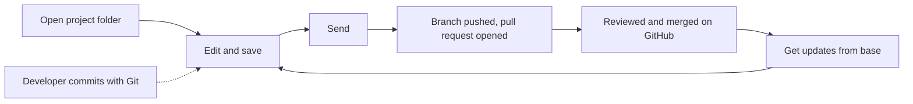

# Hybrid project scenarios

[Back to scenario index](../scenarios.md)

A hybrid project is a project folder inside a code repository, for example `contoso-app/cutready/`.
Business users edit it through a Draftline host. Developers edit the same repository with their own
tools and plain Git. Draftline is a guest in that repository: it works the way the GitHub Copilot app
does and never takes it over.

| Rule | What Draftline does |
|---|---|
| One repository | Opening a folder inside a repository joins it. Draftline never creates a nested `.git`. |
| One folder | Draftline manages one folder: the whole repository or one folder in it. A committed root `.draftline` file names it. A host with many decks keeps them inside that folder; separate copies use owned worktrees. |
| Stay in the folder | Saves, restores, and shelves read and write only the project folder. Merges bring in the whole branch but keep the developer's index and unrelated local edits. |
| Never rewrite | No squash, cleanup, or force push. Shared history only grows. |
| Share by pull request | Send pushes a branch and opens a pull request. It never pushes to the base branch. |
| Own names only | Draftline creates branches under the host's namespace (for example `cutready/`), refs under `refs/draftline/`, and `draftline-*` worktrees. It never touches other tools' refs or worktrees. The one exception: Send returns the local base branch to its upstream after moving saves off it. |

## Flow 15: open a project inside a code repository

Business goal: "Open our deck that lives in the app's repository."

| Question | Answer |
|---|---|
| Covered today? | Covered. |
| Correct primitive path | `init_with_policy` or `open_with_policy` on the project folder, then `with_variation_namespace("cutready/")`. Tauri hosts set the same namespace once on `DraftlineCommandContext::with_variation_namespace`. `scope()` returns the folder; it is empty for a standalone project. |
| Safety behavior | The enclosing repository (or linked worktree) is discovered, never nested. Changes outside the folder are invisible. A folder that resolves outside the repository is rejected. The namespace hides developers' branches; the base branch and the current branch stay listed. Creating, switching to, renaming, deleting, adopting, restoring onto, or directly publishing a branch outside the namespace fails with `VariationOutsideNamespace` (`variation_outside_namespace`); switching back to the base is allowed, and project changes are shared through Send. Like `git switch`, a switch also updates committed code that differs between branches; files with uncommitted changes in the way block it. |
| Tests | `init_in_project_folder_joins_enclosing_repo_without_nesting`, `changes_outside_project_folder_are_invisible`, `project_folder_in_linked_worktree_scopes_to_worktree`, `variation_namespace_hides_developer_branches`, `namespaced_workspace_leaves_developer_branches_alone`. |

## Flow 15a: save and go back next to a developer

Business goal: "Save my edits without disturbing the developer's code."

| Question | Answer |
|---|---|
| Covered today? | Covered. |
| Correct primitive path | `save_version`, `restore_version_as_new_save`, `shelve_changes` / `apply_shelf` as usual. |
| Safety behavior | A save builds its commit from one reading of HEAD plus the folder's changes, so it never reverts a developer commit that lands mid-save: it saves again on top of that commit. It refuses with `LocalStateChanged` instead if that commit already holds the edits, or if the branch was switched, reset, or rewound. Whatever the developer staged stays staged and uncommitted. Restores and shelves write only the folder and refuse when an untracked or ignored file is in the way. Files that need a Git filter (for example Git LFS) are never saved, overwritten, or discarded: Draftline cannot run the filter, so it refuses with a `GitFilter` hazard before writing anything. Line endings follow `core.autocrlf` and `.gitattributes` the same way Git does. When another Git process holds the index or the branch's ref lock, Draftline waits up to two seconds for it, then refuses with `GitIndexLocked` (`git_index_locked`). A lock found before an operation starts changes nothing. A lock that appears mid-operation leaves a recovery record: rollback undoes a restore only for files still at the restored version, keeps a shelf once any of its edits left the disk, and stops a discard where it is. An interrupted switch or restore onto another branch is rolled back or finished across the whole checkout, code included, so HEAD, the index, and the files never disagree; files and staged entries the developer changed meanwhile are left alone. A save updates the index before it moves the branch, as `git commit` does, and moves it only if it is still where the save started, so a failed save never leaves a commit that the developer's next commit would revert; the developer's staged changes and merge conflicts are put back. libgit2 cannot hold Git's index lock between reading and writing the index, so a Git command that starts and finishes within that sub-millisecond gap can still race a save. |
| Tests | `save_leaves_developer_staged_changes_staged_and_uncommitted`, `restore_rolls_back_only_project_content`, `shelve_and_apply_leave_code_alone`, `restore_and_switch_never_write_lfs_pointers_over_real_files`, `discard_and_shelve_never_write_lfs_pointers_over_real_files`, `switch_refuses_a_branch_whose_own_rules_put_a_file_in_lfs`, `line_endings_round_trip_like_git_with_autocrlf`, `save_waits_while_git_holds_the_index`, `a_save_that_cannot_move_the_branch_leaves_the_index_as_it_was`, `operations_that_write_the_index_refuse_while_git_holds_it`, `a_failed_save_keeps_a_developer_merge_conflict`, `saves_log_the_saver_in_the_reflog_like_git_commit`. |

## Flow 15b: developers commit with plain Git

Business goal: "See my teammates' work as part of the history."

| Question | Answer |
|---|---|
| Covered today? | Covered. |
| Correct primitive path | `versions`, `history`, and the graph APIs. |
| Safety behavior | `history`, `full_history` and the graph show every commit on the branch with its real parents, like `git log`; each entry's `touches_project` says whether it changes the folder, so a host can dim teammates' code-only commits. A merge that only takes one side's folder does not touch it. `versions` lists only commits that touch the folder (like `git log -- <folder>`), the states a business user can restore. Common ancestors and variation counts use the same full history. |
| Tests | `scoped_versions_skip_developer_commits_outside_the_project`, `scoped_history_lists_teammates_commits_and_flags_project_changes`, `a_merge_that_only_brings_one_sides_project_changes_does_not_touch_the_project`, `scoped_graph_ancestor_and_counts_include_teammates_commits`. |

## Flow 15c: send work for review

Business goal: "Share my saves with the team."

| Question | Answer |
|---|---|
| Covered today? | Covered. The host supplies a `PullRequestProvider` (for example GitHub). |
| Correct primitive path | `preflight_send(remote, &request, &mut options)` to show what will happen, then `send(remote, &request, &mut provider, &mut options)`. |
| Safety behavior | Refuses unsaved project changes. Send shares what is on the branch, like any teammate. On the base branch, or on a branch outside the namespace (a developer's), it creates a new branch in the namespace at the current commit and switches to it; the branch it left is never pushed or moved, except that a local base holding only the business user's saves returns to its upstream. It pushes without force and opens a pull request, or reuses the open one. Retrying after a failure is safe. It pushes exactly the commit it checked. Commits that change files outside the folder (a teammate's unpushed work, or a hand-made merge resolution) go along; `preflight_send` lists them in `developer_commits` so the host can show who else is in the pull request. A local base that holds them stays where it is. An explicit `request.branch` outside the namespace fails with `SendOutsideNamespace`. |
| Tests | `send_from_the_default_branch_moves_work_to_a_new_branch_and_opens_a_pull_request`, `send_retries_safely_after_the_host_fails_and_avoids_taken_branch_names`, `send_refuses_unsaved_project_changes_before_creating_a_branch`, `send_carries_a_teammates_unpushed_base_commits_and_leaves_their_base_alone`, `send_carries_a_variation_started_on_a_teammates_branch`, `send_from_a_developer_branch_moves_work_to_a_namespaced_branch`, `send_acts_only_on_the_branch_base_and_commit_the_host_approved`, `standalone_send_never_flags_developer_commits`, `send_lists_a_merge_that_resolves_code_outside_the_project`. |

## Flow 15d: get updates

Business goal: "Bring in my teammates' and the developers' latest work."

| Question | Answer |
|---|---|
| Covered today? | Covered for clean merges in the project folder. |
| Correct primitive path | `fetch_remote`, then `sync_status` or `base_status`. When only behind on the same branch, `apply_incoming`. Otherwise `preflight_merge_incoming` (same branch) or `preflight_merge_base` (base branch), then `merge_incoming` with the returned token. |
| Safety behavior | The merge covers the whole branch: project files get Draftline's resolution, other files a normal Git merge. The developer's index and unrelated local edits are kept. A conflict outside the folder is listed in the preflight's `developer_conflicts` with no token (Tauri: `merge_needs_developer`) instead of guessing. A force-pushed remote is an ordinary merge, never a rewrite. |
| Tests | `incoming_merge_keeps_teammate_code_and_the_developer_index`, `incoming_merge_leaves_code_conflicts_to_a_developer`, `bringing_in_the_latest_base_merges_everything_into_the_variation`. |

## Flow 15e: work in a separate copy

Business goal: "Start something new without touching what's open."

| Question | Answer |
|---|---|
| Covered today? | Covered in Rust; not yet exposed to Tauri or TypeScript. |
| Correct primitive path | `create_owned_worktree(dir, title, remote, WorktreeStart)`, `owned_worktrees`, `remove_owned_worktree(name, discard_changes)`. Open the returned `project_path`. |
| Safety behavior | Creates a `draftline-*` worktree on a new namespaced branch, from the last-fetched base (fetch first) or the current version. This checkout is left alone. Removal refuses unsaved work unless `discard_changes` is set, keeps the branch, and never touches other tools' worktrees. A failed create leaves nothing behind. Git LFS files arrive as pointer text until someone runs `git lfs pull` in the new copy. |
| Tests | `owned_worktree_starts_from_the_latest_base_and_leaves_this_checkout_alone`, `removing_an_owned_worktree_keeps_its_branch_and_refuses_unsaved_work`, `a_failed_owned_worktree_leaves_nothing_behind`. |

## Flow 15f: Draftline manages one folder

Business goal: "Open a second deck in the same repository."

| Question | Answer |
|---|---|
| Covered today? | Covered. |
| Correct primitive path | Draftline manages one folder of the repository: the whole repository or one folder in it. Hosts keep everything they manage inside that folder (CutReady lists its decks in `.cutready/projects.json`). For an independent copy, use an owned worktree. Before opening, `Workspace::probe(path)` (Tauri `probe_folder`, client `probeFolder`) reports the folder's state without changing anything: `not_a_repository`, `unmanaged`, `ready`, `managed_elsewhere`, `folder_missing`, `invalid_marker` or `newer_format`, with the managed folder and labelled suggestions. Pass a suggestion back unchanged to `apply_folder_fix` (client `applyFolderFix`), which re-probes, applies it, and opens the result: `open`, `manage_here` (start, create the folder, or take over from a missing or invalid one), `open_managed_folder`, `move_folder_here`, `restore_folder` (from the checked-out commit), `switch_to_branch` (up to five branches that have the folder) or `upgrade_draftline`. A fix the probe doesn't offer fails with `FolderFixUnavailable` (`folder_fix_unavailable`). `move_folder(to)` (Tauri `move_folder`, client `moveFolder`) moves the managed folder as one save that also rewrites `.draftline`: root to a subfolder, subfolder to subfolder (including into its own subfolder), and subfolder to the root only when the repository holds nothing else. |
| Safety behavior | The root `.draftline` file (`{ "format": 1, "folder": "cutready" }`, `"."` for the whole repository) names the folder. Opening a folder writes the file if the working tree lacks it, and the next save commits it, so clones and branches agree. A branch without the file falls back to the checkout's own record in its Git directory (so each linked worktree has its own), and the first folder opened claims a repository with neither. Opening or initializing any other folder, including the repository root or a folder inside the managed one, fails with `FolderIsElsewhere` (`folder_is_elsewhere`, details `{ "folder": "<folder>" }`) before anything changes; a refused `init` removes the folders it created. A handle open on a folder Draftline no longer manages fails every later operation the same way. If the managed folder is missing (renamed, deleted, or absent on the checked-out branch), opening another folder fails with `FolderMissing` (`folder_missing`, details `{ "folder": "<missing folder>" }`), so the host can offer to switch back. A handle on the managed folder gets the same error if the folder disappears while the checked-out commit still tracks it, so a save never records every file as deleted; on a branch that simply lacks the folder, it can still switch back. A `.draftline` that isn't valid (unreadable, a newer format, a folder, or a path outside the repository) fails with `InvalidFolderMarker` (`invalid_folder_marker`); deleting it resets it. The checked-out branch's `.draftline` wins: after switching to or pulling a branch that names another folder, handles on the old folder fail with `FolderIsElsewhere`, so the host reopens the named folder (which can switch back). Restores never change `.draftline`, preflights never flag it, and Send doesn't count it as a developer change. A move refuses (`FolderMoveRefused`, `folder_move_refused`) a destination with other saved files, a non-empty or reserved one, and unsaved changes (`PreflightFailed`). Untracked files in a moved subfolder follow it (`left_behind` lists any that couldn't); the root's stay. Other handles on the old folder then fail with `FolderIsElsewhere`. An interrupted move is recorded; the probe reports `ready` for either side, and repair or rollback settles on whatever the branch holds: the old folder before the save landed, the new one after. |
| Tests | `a_checkout_holds_one_workspace`, `a_refused_init_keeps_folders_that_already_existed`, `a_root_workspace_refuses_project_folders`, `each_linked_worktree_holds_its_own_workspace`, `opening_writes_the_folder_marker_and_the_next_save_commits_it`, `a_root_folder_marker_names_the_whole_repository_and_survives_restore`, `a_branch_without_the_marker_keeps_the_same_folder`, `restoring_a_version_never_brings_back_a_marker_head_lacks`, `a_committed_marker_corrects_a_stale_local_record`, `switching_to_a_branch_whose_marker_names_another_folder_follows_it`, `a_handle_on_a_folder_draftline_no_longer_manages_cant_keep_writing`, `only_the_project_that_was_interrupted_can_finish_its_recovery`, `an_unreadable_record_is_reported_and_deleting_it_resets_it`, `a_missing_folder_is_reported_until_it_comes_back`, `a_branch_without_the_folder_reports_it_missing_but_can_switch_back`, `a_record_naming_a_folder_outside_the_checkout_is_invalid`, `an_interrupted_claim_never_leaves_a_partial_one`, `a_checkout_from_an_older_draftline_is_claimed_on_first_open`, `concurrent_opens_of_different_folders_let_exactly_one_claim_the_checkout`, `probing_reports_each_folder_state_with_fixes`, `an_invalid_marker_is_fixed_by_managing_the_folder_again`, `a_fix_the_probe_does_not_offer_is_refused`, `a_deleted_folder_can_be_restored_from_its_last_save`, `a_branch_without_the_folder_offers_branches_that_have_it_or_a_new_folder`, `moving_the_folder_is_one_save_that_rewrites_the_marker`, `a_folder_can_move_into_its_own_subfolder`, `the_root_folder_moves_into_a_subfolder_and_back`, `moves_that_would_mix_with_other_files_are_refused`, `a_folder_can_be_moved_where_the_host_opened_instead`, `a_move_interrupted_before_its_save_goes_back_to_the_old_folder`, `a_move_interrupted_after_its_save_finishes_in_the_new_folder`. |

## Flow 15g: a developer switched the shared checkout

Business goal: "A developer switched branches; my work must keep going and nothing may be lost."

| Question | Answer |
|---|---|
| Covered today? | Covered. |
| Correct primitive path | Nothing special: the business user is a teammate on whatever branch is checked out. Saves, updates and merges work there, and Send moves the work to a namespaced branch (Flow 15c). To keep work apart from the developer's branch first, call `start_variation_here(name)` (Tauri `start_variation_here`, client `startVariationHere`), or `switch_variation` back to the base. An owned worktree is the other way out. |
| Safety behavior | Saves land on the checked-out branch, so the developer sees them in their history. On a detached `HEAD`, saves, save-files, restore-as-new-save, `apply_incoming` and merges fail with `NoCurrentVariation` before anything changes; `start_variation_here` is the way out. `start_variation_here` only moves `HEAD` to the new branch: files, the index, and unsaved edits stay as they are, and the developer's branch is untouched. It refuses names outside the namespace or already taken (`VariationAlreadyExists`), and refuses if `HEAD` moved while it ran (`LocalStateChanged`). On an unborn branch it only moves `HEAD`. A save pins the branch it started on and rechecks it under its ref locks, so a branch switch mid-save refuses with `LocalStateChanged` instead of landing on the other branch. |
| Tests | `saves_and_updates_work_on_a_developer_branch_like_a_teammates`, `a_detached_checkout_refuses_saves_until_a_variation_starts_here`, `a_save_refuses_a_switch_to_another_branch_at_the_same_commit`, `a_save_refuses_a_switch_to_another_branch_while_it_scans_changes`, `starting_a_variation_on_an_unborn_developer_branch_keeps_it_unborn`, `starting_a_variation_refuses_an_existing_name_and_leaves_head_alone`, `command_contract_saves_on_a_developer_branch_and_starts_a_variation_there`. |

## Flow 15h: the base branch was renamed

Business goal: "GitHub renamed `master` to `main`; my sends must follow, and my saves must not be stranded."

| Question | Answer |
|---|---|
| Covered today? | Covered. |
| Correct primitive path | Any fetch (`fetch_remote`, `fetch_all_variations`) or Send records the default branch the remote advertises. `base_status` and Send then target the new name. While a local branch still has the old name, `base_status` reports it in `base_renamed_from` (client `SyncStatus.base_renamed_from`). Saves still land on the old local branch, and Send moves them to a namespaced branch aimed at the new base. |
| Safety behavior | The advertised default is cached per remote in the repository's Git directory (`draftline/remotes/`, shared by worktrees) and ignored once the remote's URL changes. Draftline never rewrites `refs/remotes/<remote>/HEAD`, renames, or deletes the old local branch; removing it is the developer's call, and the report clears once it is gone. Offline, the last recorded default is used. |
| Tests | `a_renamed_default_branch_is_followed_and_saves_on_the_old_one_can_move`. |

## Flow 15i: Git LFS in a developer's repo

Business goal: "The developers keep images in Git LFS; don't corrupt them, and tell me why I can't save."

| Question | Answer |
|---|---|
| Covered today? | Partially covered: detection and refusal only. |
| Correct primitive path | `filtered_files()` lists project files under a filter driver (`FilteredFile { path, driver, driver_configured, content_missing }`). `filtered_files_among(paths)` probes paths that need not exist, so a host can check before it writes a screenshot. `inspect` warns with `LfsContentMissing` when project files hold LFS pointer text because the clone never downloaded their content. Client: `filteredFiles`, Tauri: `filtered_files`. `preflight_send` and `preflight_publish` list `outgoing_files` (`OutgoingFile { path, commit, size, kind }`, `kind` is `large` or `lfs_pointer`) from commits the remote doesn't advertise, so the host can block a push it shouldn't make. `outgoing_files_truncated` means the scan stopped early; treat it as unknown. Pass `SendPreflight.token` as `SendRequest.expected` so Send refuses (`local_state_changed`) if the remote, base, branch, target branch, or commit differs from what the host approved. A token approves one attempt; preflight again before retrying a failed Send. |
| Safety behavior | Draftline cannot run filter drivers, so saves, restores, discards, and checkouts touching a filtered path still refuse before writing. A checkout hazard names whose file it is: `GitFilter` for the project's, `GitFilterOutsideProject` for a developer's file outside the folder, which someone with Git and the driver must update. Pointer files are never read as content by the report; the host should not show them as images. The outgoing report never blocks; Draftline's push uploads no LFS objects, so the host should refuse an `lfs_pointer` push. |
| Tests | `a_clone_without_lfs_content_is_reported_not_read_as_content`, `smudged_lfs_files_are_not_reported_missing`, `a_developer_lfs_change_outside_the_folder_is_named_as_theirs`, `command_contract_lists_and_probes_filtered_files`, `send_and_publish_preflights_report_large_files_and_lfs_pointers_going_out`. |
| Gap | Running the real driver (`git lfs` when installed) for save, checkout, and upload on send/publish. Until then a folder-level `.gitattributes` with `-filter`, approved by a developer, is the opt-out. |