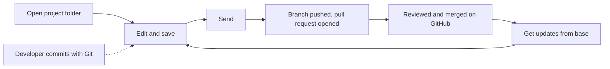

A hybrid project is a project folder inside a code repository, for example `contoso-app/cutready/`.
Business users edit it through a Draftline host. Developers edit the same repository with their own
tools and plain Git. Draftline is a guest in that repository: it works the way the GitHub Copilot app
does and never takes it over.

| Rule | What Draftline does |
|---|---|
| One repository | Opening a folder inside a repository joins it. Draftline never creates a nested `.git`. |
| Stay in the folder | Saves, restores, and shelves read and write only the project folder. Merges bring in the whole branch but keep the developer's index and unrelated local edits. |
| Never rewrite | No squash, cleanup, or force push. Shared history only grows. |
| Share by pull request | Send pushes a branch and opens a pull request. It never pushes to the base branch. |
| Own names only | Draftline creates branches under the host's namespace (for example `cutready/`), refs under `refs/draftline/`, and `draftline-*` worktrees. It never touches other tools' refs or worktrees. The one exception: Send returns the local base branch to its upstream after moving saves off it. |

## Flow 15: open a project inside a code repository

Business goal: "Open our deck that lives in the app's repository."

| Question | Answer |
|---|---|
| Covered today? | Covered. |
| Correct primitive path | `init_with_policy` or `open_with_policy` on the project folder, then `with_variation_namespace("cutready/")`. Tauri hosts set the same namespace once on `DraftlineCommandContext::with_variation_namespace`. `scope()` returns the folder; it is empty for a standalone project. |
| Safety behavior | The enclosing repository (or linked worktree) is discovered, never nested. Changes outside the folder are invisible. A folder that resolves outside the repository is rejected. The namespace hides developers' branches; the base branch and the current branch stay listed. Creating, switching to, renaming, deleting, adopting, restoring onto, or directly publishing a branch outside the namespace fails with `VariationOutsideNamespace` (`variation_outside_namespace`); switching back to the base is allowed, and project changes are shared through Send. |
| Tests | `init_in_project_folder_joins_enclosing_repo_without_nesting`, `changes_outside_project_folder_are_invisible`, `project_folder_in_linked_worktree_scopes_to_worktree`, `variation_namespace_hides_developer_branches`, `namespaced_workspace_leaves_developer_branches_alone`. |

## Flow 15a: save and go back next to a developer

Business goal: "Save my edits without disturbing the developer's code."

| Question | Answer |
|---|---|
| Covered today? | Covered. |
| Correct primitive path | `save_version`, `restore_version_as_new_save`, `shelve_changes` / `apply_shelf` as usual. |
| Safety behavior | A save builds its commit from HEAD plus the folder's changes. Whatever the developer staged stays staged and uncommitted. Restores and shelves write only the folder and refuse when an untracked or ignored file is in the way. |
| Tests | `save_leaves_developer_staged_changes_staged_and_uncommitted`, `restore_rolls_back_only_project_content`, `shelve_and_apply_leave_code_alone`. |

## Flow 15b: developers commit with plain Git

Business goal: "See the developer's edits to our project as part of its history."

| Question | Answer |
|---|---|
| Covered today? | Covered. |
| Correct primitive path | `versions`, `history`, and the graph APIs. |
| Safety behavior | Commits that touch the folder show up as versions, whoever made them. `versions` hides code-only commits; `history` links across them but keeps the current HEAD as an anchor. |
| Tests | `scoped_versions_skip_developer_commits_outside_the_project`, `scoped_history_rewrites_parents_across_hidden_commits_and_pins_head`, `scoped_history_follows_the_side_that_brought_project_changes_through_a_merge`. |

## Flow 15c: send work for review

Business goal: "Share my saves with the team."

| Question | Answer |
|---|---|
| Covered today? | Covered. The host supplies a `PullRequestProvider` (for example GitHub). |
| Correct primitive path | `send(remote, &request, &mut provider, &mut options)`. |
| Safety behavior | Refuses unsaved project changes. On the base branch, Send moves the saves to a new branch in the namespace, then returns the local base to its upstream. It pushes without force and opens a pull request, or reuses the open one. Retrying after a failure is safe. |
| Tests | `send_from_the_default_branch_moves_work_to_a_new_branch_and_opens_a_pull_request`, `send_retries_safely_after_the_host_fails_and_avoids_taken_branch_names`, `send_refuses_unsaved_project_changes_before_creating_a_branch`. |

## Flow 15d: get updates

Business goal: "Bring in my teammates' and the developers' latest work."

| Question | Answer |
|---|---|
| Covered today? | Covered for clean merges in the project folder. |
| Correct primitive path | `fetch_remote`, then `sync_status` or `base_status`. When only behind on the same branch, `apply_incoming`. Otherwise `preflight_merge_incoming` (same branch) or `preflight_merge_base` (base branch), then `merge_incoming` with the returned token. |
| Safety behavior | The merge covers the whole branch: project files get Draftline's resolution, other files a normal Git merge. The developer's index and unrelated local edits are kept. A conflict outside the folder is listed in the preflight's `developer_conflicts` with no token (Tauri: `merge_needs_developer`) instead of guessing. A force-pushed remote is an ordinary merge, never a rewrite. |
| Tests | `incoming_merge_keeps_teammate_code_and_the_developer_index`, `incoming_merge_leaves_code_conflicts_to_a_developer`, `bringing_in_the_latest_base_merges_everything_into_the_variation`. |

## Flow 15e: work in a separate copy

Business goal: "Start something new without touching what's open."

| Question | Answer |
|---|---|
| Covered today? | Covered in Rust; not yet exposed to Tauri or TypeScript. |
| Correct primitive path | `create_owned_worktree(dir, title, remote, WorktreeStart)`, `owned_worktrees`, `remove_owned_worktree(name, discard_changes)`. Open the returned `project_path`. |
| Safety behavior | Creates a `draftline-*` worktree on a new namespaced branch, from the last-fetched base (fetch first) or the current version. This checkout is left alone. Removal refuses unsaved work unless `discard_changes` is set, keeps the branch, and never touches other tools' worktrees. A failed create leaves nothing behind. |
| Tests | `owned_worktree_starts_from_the_latest_base_and_leaves_this_checkout_alone`, `removing_an_owned_worktree_keeps_its_branch_and_refuses_unsaved_work`, `a_failed_owned_worktree_leaves_nothing_behind`. |

## Flow 15f: an operation was interrupted in another project

Business goal: "Another deck in this repository was interrupted; what can I do?"

| Question | Answer |
|---|---|
| Covered today? | Covered. |
| Correct primitive path | `inspect` reports `recovery_in_other_project` with next action `finish_in_other_project`. |
| Safety behavior | Projects in one checkout share its branch, so the operation lock and the recovery record are per checkout. An unfinished operation blocks every project there, but only the project that started it can repair, roll back, or acknowledge it. Others get `RecoveryInOtherProject`. |
| Tests | `only_the_project_that_was_interrupted_can_finish_its_recovery`. |
